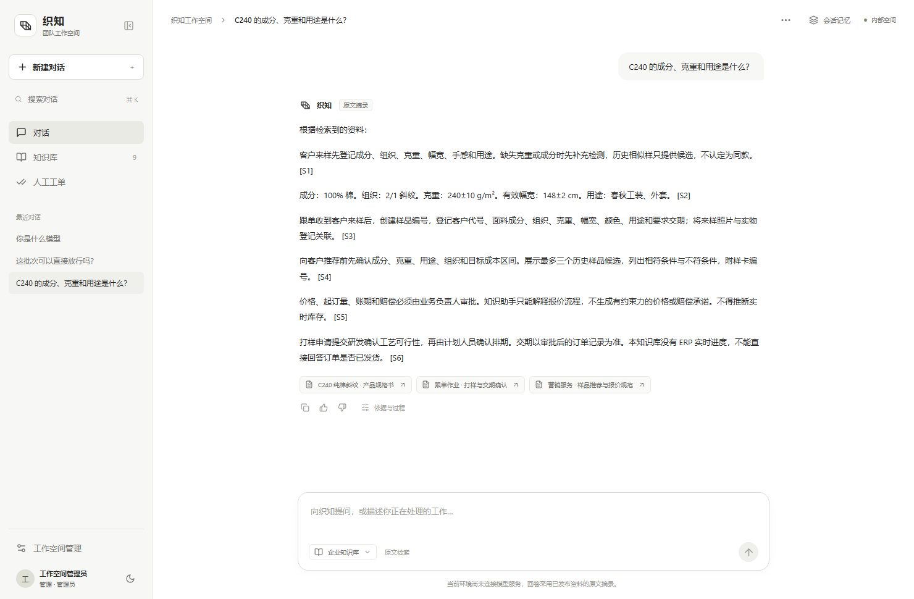

# 织知 · 纺织企业知识助手

面向规格书、工艺记录与业务指引的个人 RAG 实践项目，使用模拟业务资料和公开 PDF。关注正确资料、授权版本与可核对的回答，可在本地运行。

## 先看一条完整业务流程

维护人员上传资料，检查切片与索引状态，管理员审核发布；员工询问面料参数，系统在授权资料内检索，返回原文摘录或带引用的回答，并展示文档版本、PDF 页码与检索过程。需要审批的业务判断转人工工单。

## 实现重点

- 文档管理：PDF 按物理页解析，保留章节，支持调整切片、重建索引与版本替换。
- 混合检索：BM25 与 BGE 向量召回，RRF 融合，MMR 与去重，Rerank 精排和本地证据阈值。
- 权限控制：按部门和发布状态过滤，返回前与历史阅读时再次校验来源权限。
- 会话处理：提取明确面料条件，支持省略编号的连续追问、条件清除和过期。
- 过程诊断：查看改写问题、候选数量、精排分数与引用，区分入库、召回、排序和生成问题。

## 界面与演示顺序

先查 C240 的克重与幅宽，再追问缩水率并核对引用。进一步可在本地演示 LY317 上传 → 切片检查 → 未发布查询 → 审核发布 → 再次问答，验证知识维护闭环。当前截图未接入生成模型，展示的是检索原文摘录，不是实时生成。

## 评测与边界

仓库已存档的 10 题检索评测中，BM25 与混合链路对 9 道可回答题的 Hit@6 均为 1.0，MRR@6 为 0.926 / 0.944；无答案题仅 1 道。结果只能说明当前小样本表现，不能代表生产准确率；本次未重新运行评测。

扫描 PDF 需要另行 OCR，复杂表格与大规模并发尚待验证。未接入真实 ERP、企微和企业业务数据，未作为公司生产系统交付。

## 进一步查看

- [源码、启动步骤与完整项目介绍](https://github.com/Lemon1216yu/textile-rag-assistant)
- [RAG 设计与实现](https://github.com/Lemon1216yu/textile-rag-assistant/blob/main/docs/RAG设计与实现.md)
- [操作手册（下载 HTML 后打开）](https://github.com/Lemon1216yu/textile-rag-assistant/blob/main/使用说明.html)
- [返回作品集网站](https://lemon1216yu.github.io/ai-portfolio/#rag)
